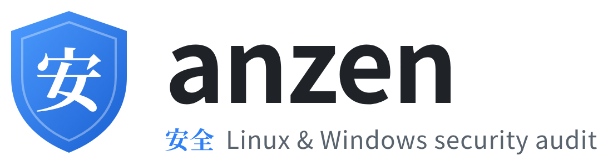
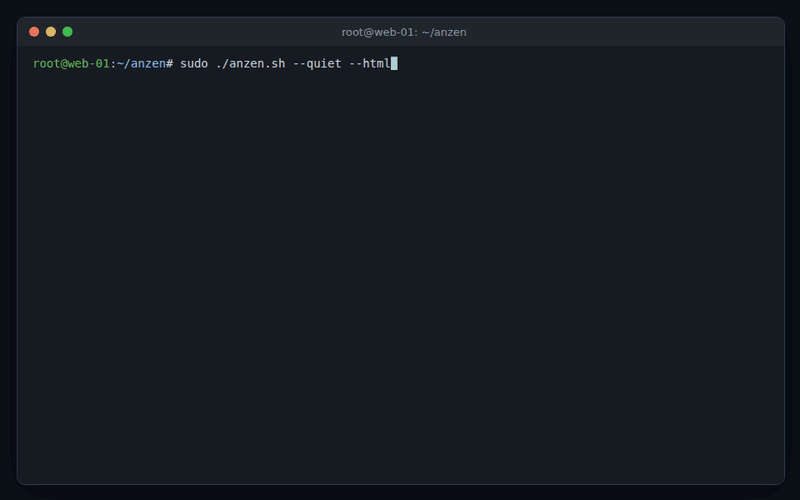
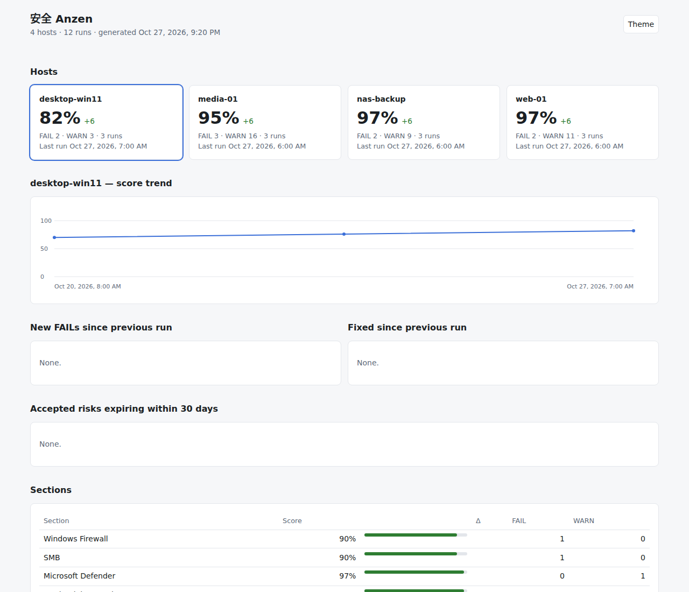

<p align="center">
  <picture>
    <source media="(prefers-color-scheme: dark)" srcset="docs/img/logo-dark.png">
    
  </picture>
</p>

<p align="center">
  <b>One self-hosted tool to audit your Linux and Windows hosts:</b><br>
  hardening, containers, known CVEs and exposed services. It tells you what is wrong, how to fix it, and what changed since last week.
</p>

<p align="center">
  <a href="https://github.com/anzen-d/anzen/actions/workflows/ci.yml"></a>
  <a href="LICENSE"></a>
  
  
  
</p>

<p align="center">
  
</p>

---

## Why anzen?

Homelabs and small fleets drift: a container mounts the Docker socket, a key
ends up world-readable, a new CVE lands in an image you pulled months ago.
Anzen checks all of that in one run and keeps a history, so the weekly report
answers **"what got worse?"** instead of listing the same 300 lines again.

The name comes from Japanese: **安全 (anzen)** means *safety* or *security*.
安 (*an*) stands for peace and ease, 全 (*zen*) for whole or complete, so together
the characters suggest *complete peace of mind*. That is the goal of the
tool: know the whole state of your machines and stop worrying about them.

- **22 Linux check modules:** SSH, sudo and users, kernel sysctls, file permissions, secrets, systemd sandboxing, TLS, firewall, Docker/Podman/LXD/k8s, image freshness, local and external pentest.
- **Known CVEs** in host packages and in **every running container image**, via [Trivy](https://trivy.dev).
- **Windows edition:** Defender, firewall, BitLocker, SMBv1, RDP/NLA, LSA protection and more, with the same report format.
- **History and dashboard:** per-host score trends, new and fixed problems, all in one static HTML page.
- **Alerts only when something new breaks**, via ntfy or any command, plus a dead-man switch.
- **Accepted risks with expiry dates**, so known exceptions stay quiet but never forever.
- **Fleet mode:** `--remote=host1,host2` audits hosts over SSH without installing anything there.
- **HTML, TXT, JSON and SARIF reports**, plus a generated `remediate.sh` with the fix commands.
- **No dependencies:** plain Bash and standard tools; Trivy, curl and Docker only unlock extra checks.

<p align="center">
  
</p>

## Quick start

### Linux

```bash
git clone https://github.com/anzen-d/anzen.git
cd anzen
sudo ./anzen.sh            # audit this host, results in the terminal
sudo ./anzen.sh --html     # ...and write reports/anzen_<timestamp>.html
./anzen-tui.sh             # menu-driven interface
```

Root (or passwordless sudo) gives complete results. Without it anzen still
runs and tells you which checks were limited.

Install it system-wide with shell completions (`/usr/local/bin/anzen`):

```bash
sudo ./install.sh
anzen --help
```

Optional extras: install [Trivy](https://trivy.dev/latest/getting-started/installation/)
for CVE scanning, and `curl` for notifications and image update checks.

### Windows

From an elevated PowerShell in the cloned folder:

```powershell
powershell -ExecutionPolicy Bypass -File .\windows\anzen.ps1 -Json
```

### Audit other machines

```bash
./anzen.sh --remote=root@server1,root@server2 --html    # needs SSH keys, nothing installed remotely
```

## Common workflows

**Look at one area only**

```bash
sudo ./anzen.sh --check=ssh --check=kernel
sudo ./anzen.sh --check=cve                  # host + all running container images (needs trivy)
```

**Accept a known risk** (with an expiry date). Each finding has a stable ID,
shown in the reports:

```bash
echo "container-security-9bdb5279  2027-01-31  Portainer needs the Docker socket" >> anzen.accept
```

**Weekly audit, alert only on new problems, dashboard for all hosts.** Put this
in `/etc/anzen/anzen.conf` (see [`anzen.conf.example`](anzen.conf.example)):

```bash
HISTORY_DIR="/var/lib/anzen/history"
DASHBOARD_FILE="/var/lib/anzen/www/index.html"
NOTIFY_NTFY_URL="https://ntfy.sh/your-topic"
NOTIFY_ON=regression
```

```bash
sudo ./anzen.sh --config=/etc/anzen/anzen.conf --parallel --schedule=weekly:04:30
```

**Use it in CI**

```bash
./anzen.sh --quiet --sarif --output=anzen.sarif.json    # exit 1 on FAIL; SARIF for code scanning
```

## What it checks

| Area | Modules |
|------|---------|
| System and accounts | `system`, `users`, `logins`, `packages`, `services`, `auditd` |
| Access and network | `ssh`, `network`, `network2`, `tls` |
| Kernel and filesystem | `kernel`, `modules`, `files`, `path_check`, `compiler`, `systemd_hardening` |
| Secrets | `secrets` |
| Containers | `docker_security`, `images` |
| Vulnerabilities | `cve` (Trivy) |
| Active testing | `pentest`, `pentest_external` |
| Windows | `system`, `updates`, `defender`, `firewall`, `accounts`, `passwords`, `uac`, `bitlocker`, `smb`, `rdp`, `credentials`, `powershell`, `secureboot`, `network` |

Every finding is **FAIL** (fix it), **WARN** (review it), **OK** or **INFO**,
mostly with a copy-paste fix. Full list in [docs/modules.md](docs/modules.md).

> ⚠️ `pentest` and `pentest_external` actively probe ports and URLs. Only point them at
> systems you own or are explicitly authorised to test.

## Documentation

| | |
|---|---|
| [Installation](docs/installation.md) | Requirements, installer, optional tools |
| [Usage](docs/usage.md) | All flags, examples, the TUI, exit codes |
| [Modules](docs/modules.md) | Every check, pentest modules, CVE scanning, custom checks |
| [Reports & history](docs/reports.md) | Report formats, finding IDs, baselines, accepted risks, dashboard, remediation |
| [Configuration](docs/configuration.md) | Every `anzen.conf` setting |
| [Fleet, scheduling & CI](docs/fleet.md) | `--remote`, cron schedules, CI pipelines |
| [Windows](docs/windows.md) | The PowerShell edition |

## How anzen compares

| Tool | What it is | Where anzen differs |
|------|------------|---------------------|
| [Lynis](https://github.com/CISOfy/lynis) | Mature host hardening audit | Lynis has far more checks and platforms. Anzen adds container image CVEs and freshness, history and a dashboard, alerts on new findings, expiring accepted risks, fleet over SSH and Windows |
| [docker-bench-security](https://github.com/docker/docker-bench-security) | CIS Docker benchmark | Anzen treats Docker as one part of a host audit |
| [Trivy](https://github.com/aquasecurity/trivy) / Grype | Vulnerability scanners | Anzen runs Trivy and adds the hardening context |
| OpenSCAP, CIS-CAT | Formal compliance profiles | Anzen is lighter and opinionated, not a compliance attestation |

## Contributing

Bug reports, false-positive reports and new checks are very welcome. See
[CONTRIBUTING.md](CONTRIBUTING.md) to get started (`make ci` runs the
tests). Please report security issues privately, as described in
[SECURITY.md](SECURITY.md).

## License

[MIT](LICENSE)
