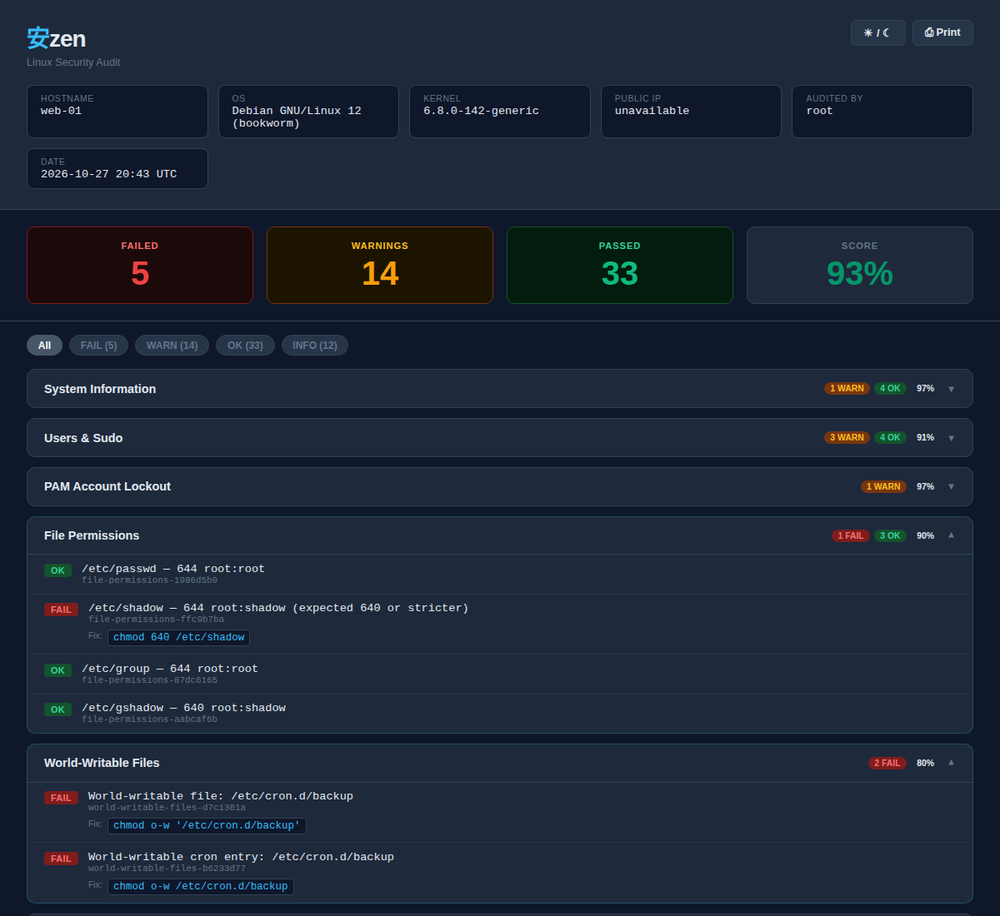

# Reports, history and risk tracking


## Report Formats

### Terminal
Colour-coded live output with section headers and a summary score card.

```
━━━━━━━━━━━━━━━━━━━━━━━━━━━━━━━━━━━━━━━━━━
  SUMMARY
━━━━━━━━━━━━━━━━━━━━━━━━━━━━━━━━━━━━━━━━━━
  SSH Configuration             80%   FAIL 1   WARN 3
  Container Security             0%   FAIL 2   WARN 40

  Repeated:
    18× WARN No memory limit
    12× WARN Running as root
━━━━━━━━━━━━━━━━━━━━━━━━━━━━━━━━━━━━━━━━━━
  FAIL: 3   WARN: 43   OK: 52   Score: 88%
━━━━━━━━━━━━━━━━━━━━━━━━━━━━━━━━━━━━━━━━━━
```

Each section scores `100 - (FAILs × 10) - (WARNs × 3)`, minimum 0; the overall
score is the mean of the section scores, so one noisy section cannot pin the
whole host at 0%. Penalties are configurable via `anzen.conf`. Messages that
share a prefix (text before `:`) three or more times are grouped under
*Repeated*.

Every WARN/FAIL has a stable **finding ID** such as `container-security-9bdb5279`:
the section plus a hash of the message with volatile parts (percentages, sizes,
durations, counts) normalised. IDs are what `--diff` and the
[accept file](#accepted-risks) match on, and they appear in every report.

### HTML
Self-contained dark-theme report with collapsible sections, colour-coded findings, and a score card. No external dependencies — single file.



[Open the sample report](https://anzen-d.github.io/anzen/report.html) (a demo host with three planted mistakes).

### Plain Text
Structured audit trail with section headers and tab-delimited findings. Suitable for archiving, email, or diffing.

### JSON
Machine-readable output:

```json
{
  "hostname": "server1", "os": "...", "kernel": "...", "date": "...",
  "summary": { "fail": 3, "warn": 43, "ok": 52, "info": 12, "score": 88 },
  "durations": { "ssh": 1, "files": 312, "cve": 95 },
  "sections": [
    { "name": "SSH Configuration", "fail": 1, "warn": 3, "ok": 9, "score": 80 }
  ],
  "findings": [
    { "id": "ssh-configuration-1c0e5a7d", "level": "FAIL", "section": "SSH Configuration",
      "message": "PermitRootLogin: yes", "remedy": "..." }
  ]
}
```

`durations` (seconds per module) is written by the Linux edition only.

### SARIF
SARIF 2.1.0 for GitHub/GitLab code scanning. Each result carries the finding ID
in `partialFingerprints.anzenFindingId/v1`, so alerts track across runs.

## Baseline & Diff

Save a snapshot of the current findings, then detect regressions on future runs:

```bash
# Save baseline
sudo ./anzen.sh --baseline

# Later — diff against it (exits 2 if anything regressed)
sudo ./anzen.sh --diff

# Combine with JSON for machine-readable diff output
sudo ./anzen.sh --diff --json
```

The baseline is saved to `reports/.baseline.json`. A `FAIL` whose finding ID is
not in the baseline counts as a regression; a FAIL whose numbers changed (e.g.
disk 91% → 95%) keeps its ID and is not. Baselines from versions before 0.5.0
hold messages only — they are compared by message until you re-run `--baseline`.

## Accepted Risks

Some findings are intentional — Portainer needs the Docker socket. List them in
`anzen.accept` (or the file named by `ACCEPT_FILE`), one per line:

```
# ID                         expires     reason
container-security-9bdb5279  2027-01-31  Portainer needs the Docker socket to manage stacks
```

Take the ID from any report. Until the date passes, the finding is reported as
`INFO` with the reason and does not affect the score or exit code. Afterwards it
returns at its real level, marked "acceptance expired". The date is mandatory,
so nothing stays accepted forever. The file must be owned by you or root and
not world-writable — the same rule as `anzen.conf`.

## History & Dashboard

Keep every run and get a trend view across one or many hosts:

```bash
# Save runs to a history dir (or set HISTORY_DIR in anzen.conf)
sudo ./anzen.sh --history=/var/lib/anzen/history

# Build a static dashboard from it — one HTML file, no network access
./anzen.sh --history=/var/lib/anzen/history --dashboard=/var/lib/anzen/www/index.html
```

Runs land in `HISTORY_DIR/<host>/<timestamp>.json`; the newest `HISTORY_KEEP`
(default 52) are kept. Point several hosts at a shared directory for a fleet view.
Set `DASHBOARD_FILE` to rebuild the dashboard after every run.

The dashboard shows each host's score and change, a stale marker when the last
run is older than 8 days, the score trend, FAILs that are new or fixed since the
previous run, accepted risks expiring within 30 days, section scores and a
filterable findings table. It contains your findings, including file paths of
exposed secrets, so serve it read-only and behind authentication.

A typical unattended setup in `anzen.conf`:

```bash
HISTORY_DIR="/var/lib/anzen/history"
DASHBOARD_FILE="/var/lib/anzen/www/index.html"
NOTIFY_NTFY_URL="https://ntfy.example.com/alerts"
NOTIFY_ON=regression                       # only when a new FAIL appears
HEARTBEAT_URL="https://kuma.example.com/api/push/XXXX?status=up"
```

```bash
sudo ./anzen.sh --config=/etc/anzen/anzen.conf --parallel --schedule=weekly:04:30
```

## Remediation

`--remediate` generates a shell script with fix commands for each `FAIL` finding that has a known remedy:

```bash
sudo ./anzen.sh --remediate
# Writes: reports/remediate_TIMESTAMP.sh

# Review before running
less reports/remediate_*.sh

# Apply
sudo bash reports/remediate_*.sh
```

---

[← Back to README](../README.md)
